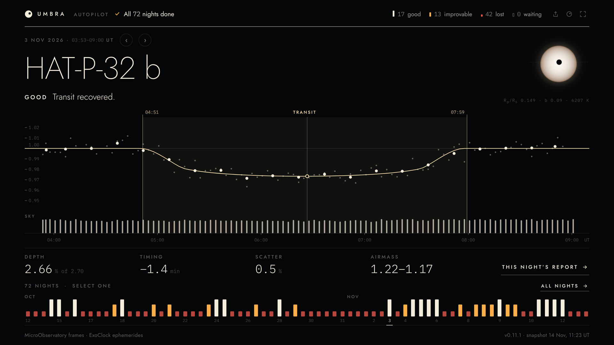
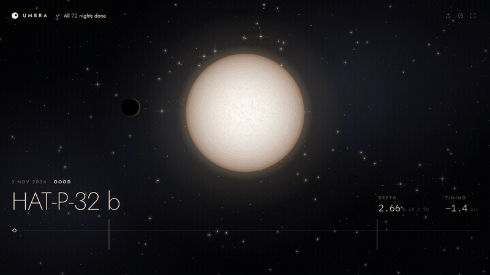

# Umbra

Umbra watches the public [MicroObservatory image directory](https://waps.cfa.harvard.edu/microobservatory/MOImageDirectory/ImageDirectory.php) and works through every exoplanet transit night in it on its own. Start it, leave it running, and look at its page when you like.

It is for people who take part in NASA's [Exoplanet Watch](https://science.nasa.gov/citizen-science/exoplanet-watch/) and reduce MicroObservatory data with [EXOTIC](https://github.com/rzellem/EXOTIC). It is a personal project, not affiliated with Exoplanet Watch, MicroObservatory or AAVSO, and it is young: the name may still change.





For each night it:

1. finds the transit runs in the listing (20 or more frames on one target), predicts the transit from [ExoClock](https://www.exoclock.space), or from the [NASA Exoplanet Archive](https://exoplanetarchive.ipac.caltech.edu) for planets ExoClock lacks, and skips nights that miss part of it;
2. downloads eight frames, counts stars, and skips clouded nights;
3. downloads the rest, measures a quick light curve, and grades the night **good**, **improvable** or **lost**, with the reason;
4. runs EXOTIC on the clear frames, if EXOTIC is installed, and checks its answer before calling the night good;
5. deletes the frames of lost nights after two days.

Beside the share button, one to three small bars say how well a night's curve shows the dip to someone who just looks at it, and the three best nights are ringed in the row of nights. This is apart from the verdict: a night can be good to upload and still be a poor picture.

It never uploads anything itself. Press Upload (or U) and it takes you through the good nights one at a time: it puts the two files in a folder of their own, opens AAVSO's form, and when you come back it finds the night on your public AAVSO page and says so. Nights that are already there are not offered again.

## Install

Needs Python 3.10 or newer, on macOS or Linux. Windows is untested.

```
git clone https://github.com/Sting1JP/umbra-transit.git
cd umbra-transit
python -m pip install -r requirements.txt
```

An EXOTIC environment already has everything Umbra needs: run Umbra with that Python and skip the last line.

## Run

From the `umbra-transit` folder:

```
python -m umbra                  # start; opens http://localhost:8765
python -m umbra --observer CODE  # your AAVSO observer code, written into the reports (remembered)
python -m umbra --once           # one pass, print the verdicts, exit
python -m umbra --log            # every night and why, plus findings worth reporting
python -m umbra --events         # what it did lately, errors included
python -m umbra --lan            # let other devices on your network see the page (read-only)
```

On the page, ← and → move between nights, M switches to the minimal view, F is full screen, C copies the night as an image to share, and U opens the upload screen.

On a Mac you can also double-click `Umbra.command`: it starts Umbra with the Python environment in `~/exotic-new` or `~/exotic-env` (or the one named in `UMBRA_ENV`) and keeps the Mac awake while it runs. Add it to Login Items to start with the Mac.

Data lives in `~/Documents/Astro/data/exoplanetwatch/umbra`; change it with `--data` or `UMBRA_DATA`. Each night is a folder under `nights/`, laid out like an Exoplanet Watch checkout, so you can also run EXOTIC on it by hand.

## EXOTIC

Umbra uses the EXOTIC in its own environment, or the one named in `UMBRA_EXOTIC`. It works with the 4.3.1 release and with the newer development line (branch `michael_fitzgeralds_wonderful_branch_of_magic`), which finds comparison stars better on MicroObservatory frames. The newer one needs Python 3.12+, so give it its own environment and pin a commit:

```
python3.12 -m venv ~/exotic-new
~/exotic-new/bin/pip install "git+https://github.com/rzellem/EXOTIC@1fc4a65"
UMBRA_EXOTIC=~/exotic-new/bin/exotic python -m umbra
```

Nights that came out weak on 4.3.1 are redone once the newer EXOTIC is in use.

## Left running

- No network: it waits and tries again. An outage never counts against a night.
- Less than 2 GB free: downloads pause.
- Started twice: the second start opens the page of the first.
- Quit, killed or put to sleep: it picks up where it was, and takes a running EXOTIC down with it.
- EXOTIC fails on a night: one more try a day, three times.
- A new version screens or reads better: lost nights still on disk and nights it could not process get another look, and EXOTIC's results are read again without running it.

## Safety

- The page is served to this computer only. `--lan` opens it to your network, read-only.
- Umbra contacts six hosts, over HTTPS, and refuses redirects: the two MicroObservatory hosts, ExoClock, the NASA Exoplanet Archive, MAST, and AAVSO (only to read your public list of uploads). EXOTIC is a separate program and makes its own connections.
- Frame names are checked before they become file names, and every frame must be a complete FITS file.
- Only folders Umbra created are ever deleted.
- To stay light on the MicroObservatory server, the listing is read once a day, also across restarts, and frames are downloaded one at a time with a one-second pause, each of them once. If a server answers that it is busy (HTTP 429 or 5xx) or does not answer, Umbra leaves it alone for ten minutes, then twenty, and so on up to a day, or for as long as the server asks. Every request names Umbra, its version and this repository, so the people who run a server can see what it is and reach the author.
- EXOTIC runs with no keyboard attached and a time limit, so a question or a stall ends the run.

## Code

| File | Job |
|---|---|
| `config.py` | settings and fixed facts |
| `net.py` | the only code that touches the network |
| `directory.py` | listing, nights, downloads |
| `ephemeris.py` | ExoClock and NASA Exoplanet Archive lookup, transit prediction |
| `photometry.py` | star detection, plate solving, aperture photometry |
| `screen.py` | measures a night |
| `grade.py` | turns measurements into a verdict |
| `reduce.py` | runs EXOTIC and checks its result |
| `digest.py` | the night log |
| `store.py` | SQLite state |
| `pipeline.py` | the stages and the background worker |
| `server.py`, `web/` | the page |

Tests: `python -m pytest tests`

## Credit

Frames: MicroObservatory, Center for Astrophysics | Harvard & Smithsonian. Ephemerides: ExoClock and the NASA Exoplanet Archive. Star catalog: TESS Input Catalog via MAST.

## License

MIT, see `LICENSE`. The two fonts in `umbra/web/fonts` are under the SIL Open Font License 1.1.
